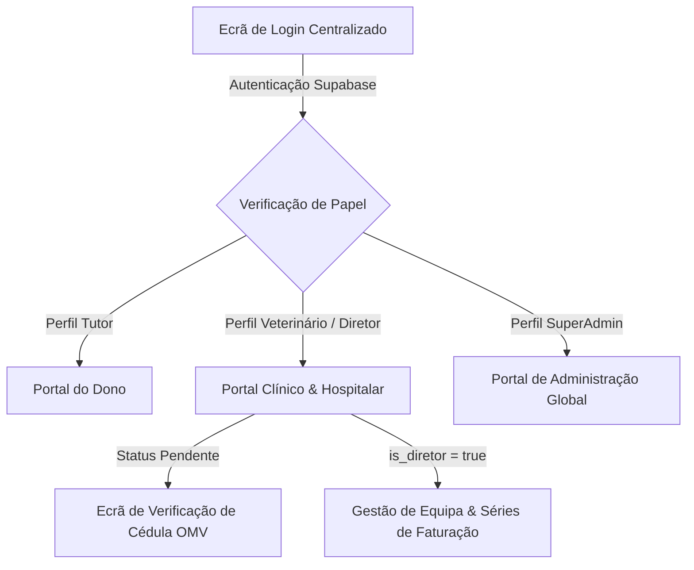
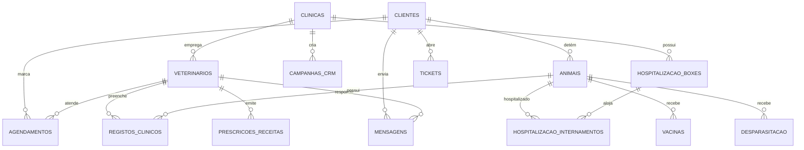

# 🐾 Zooni — Sistema Integrado de Gestão Veterinária e Saúde Animal
### Prova de Aptidão Profissional (PAP) · Curso Profissional de Gestão e Programação de Sistemas Informáticos

---

## 📋 Índice
1. [Sobre o Projeto](#-sobre-o-projeto)
2. [Problema e Proposta de Valor](#-problema-e-proposta-de-valor)
3. [Perfis de Utilizador](#-perfis-de-utilizador)
4. [Módulos e Funcionalidades Principais](#-módulos-e-funcionalidades-principais)
   - [Portal do Tutor / Dono do Animal](#1-portal-do-tutor--dono-do-animal)
   - [Portal Clínico do Médico Veterinário](#2-portal-clínico-do-médico-veterinário)
   - [Módulo de Internamento & Hospitalização](#3-módulo-de-internamento--hospitalização)
   - [Gestão da Clínica e Direção Clínica](#4-gestão-da-clínica-e-direção-clínica)
   - [Módulo de CRM & Campanhas de Profilaxia](#5-módulo-de-crm--campanhas-de-profilaxia)
   - [Telemedicina e Chat em Tempo Real](#6-telemedicina-e-chat-em-tempo-real)
   - [Portal de Administração Global (SuperAdmin)](#7-portal-de-administração-global-superadmin)
5. [Arquitetura Tecnológica](#-arquitetura-tecnológica)
6. [Base de Dados & Esquema Relacional](#-base-de-dados--esquema-relacional)
7. [Segurança e Conformidade](#-segurança-e-conformidade)
8. [Estrutura de Ficheiros do Projeto](#-estrutura-de-ficheiros-do-projeto)
9. [Instalação e Execução Local](#-instalação-e-execução-local)
10. [Configuração do Supabase](#-configuração-do-supabase)
11. [Créditos e Licença](#-créditos-e-licença)

---

## 🌟 Sobre o Projeto

O **Zooni** é uma plataforma web integral concebida para modernizar e digitalizar o ecossistema dos cuidados de saúde animal em Portugal. Desenvolvido no âmbito da **Prova de Aptidão Profissional (PAP)**, o sistema estabelece uma ponte inteligente entre **Tutores de Animais de Estimação**, **Médicos Veterinários**, **Centros de Atendimento Médico-Veterinários (CAMV)** e a **Administração Global do Sistema**.

A aplicação combina uma caderneta de saúde digital interativa, prontuário médico eletrónico avançado (CAMV), sistema de agendamento em tempo real, gestão hospitalar com visualização de boxes e turnos de enfermagem, telemedicina assíncrona/síncrona e automação de campanhas de saúde preventiva.

---

## 💡 Problema e Proposta de Valor

### Desafios no Setor Veterinário Tradicional:
- **Perda de Histórico Clínico:** Boletins de vacinas físicos extraviados, dificuldade no acesso a registos de consultas anteriores e diagnósticos em clínicas distintas.
- **Sobrecarga Administrativa nas Clínicas:** Gestão fragmentada de jaulas/boxes de internamento, folhas de tratamento em papel sujeitas a erros de dosagem ou omissão de faturação de consumíveis.
- **Dificuldade de Triagem e Comunicação:** Tutores sem canal direto e seguro para esclarecimento de dúvidas pré-consulta ou acompanhamento de pós-operatório.
- **Falta de Prevenção Proativa:** Falhas sistemáticas no cumprimento de prazos de vacinação e desparasitações por falta de lembretes automáticos.

### Solução Zooni:
- **Caderneta Digital Única:** O tutor tem no telemóvel ou computador a ficha biométrica, vacinas, desparasitações, peso e exames do seu animal.
- **Prontuário Veterinário Completo (VeNom, PACS, Análises):** Registo padronizado de consultas, anamnese, exames de imagiologia e resultados laboratoriais.
- **Módulo Visual de Hospitalização:** Controlo visual de boxes (Canil, Gatil, UCI, Isolamento), folhas de turno com medicação horária, sinais vitais e lançamento automático de gastos na fatura.
- **CRM e Comunicação Multicanal:** Disparo segmentado de campanhas profiláticas (leishmaniose, raiva, desparasitações) via WhatsApp, Email e Notificações in-app.

---

## 👥 Perfis de Utilizador

O sistema implementa **Controlo de Acesso Baseado em Funções (RBAC)** em 4 níveis:



1. **Tutor / Dono de Animal:** Registo simples, adição e acompanhamento dos animais de estimação, marcação de consultas, histórico de vacinas e chat com o veterinário assistente.
2. **Médico Veterinário:** Visualização da agenda de consultas, acesso às fichas clínicas dos pacientes, registo de diagnósticos, prescrição eletrónica, triagem de tickets e atendimento via chat.
3. **Diretor Clínico / Gestor de Clínica:** Todas as funcionalidades médicas acrescidas de gestão da equipa de veterinários (residentes/externos), comissões, aprovação de novos membros e supervisão do módulo de internamento hospitalar.
4. **Super Administrador (SuperAdmin):** Gestão geral da plataforma, validação de clínicas e verificação de carteiras profissionais/cédulas OMV dos veterinários, auditoria de dados e moderação.

---

## 🚀 Módulos e Funcionalidades Principais

### 1. Portal do Tutor / Dono do Animal
- **Dashboard do Tutor (`dashboard_dono.html`):**
  - Resumo imediato dos animais registados, próximas vacinas a caducar, alertas de desparasitação e consultas agendadas.
  - Acesso direto ao contacto de urgência 24h e marcação de apoio imediato.
  - Gráfico de acompanhamento de peso de cada animal.
- **Caderneta Digital de Saúde (`meus_animais.html`):**
  - Adição de novos animais com fotografia tratada via ferramenta integrada de recorte de imagem (`image_cropper.js`).
  - Ficha completa: Nome, espécie (cão, gato, exótico, etc.), raça, data de nascimento, sexo, estado de esterilização, número de microchip, peso, alergias e doenças crónicas.
  - Registo e histórico de vacinas administradas com upload do comprovativo.
  - Plano de desparasitações internas e externas.
- **Agenda do Dono (`agenda_dono.html`):**
  - Marcação de consultas online com seleção de clínica, médico veterinário e tipo de serviço (Consulta de Rotina, Vacinação, Cirurgia, Teleconsulta ou Urgência).
  - Seleção de data e hora com prevenção de conflitos de horário.
  - Histórico de marcações com estados: *Pendente*, *Confirmado*, *Concluído* e *Cancelado*.
- **Definições e Perfil (`definicoes_dono.html`):**
  - Alteração de dados de contacto, morada, preferências de comunicação e personalização de tema visual.

---

### 2. Portal Clínico do Médico Veterinário
- **Dashboard Médico (`dashboard_veterinario.html`):**
  - Indicadores diários: Consultas do dia, novos pacientes, animais em internamento e tickets em fila de triagem.
  - Agenda rápida do dia com identificação do paciente, tutor e motivo.
  - Atalhos operacionais para abertura de nova consulta ou admissão hospitalar.
- **Ficha Clínica e Prontuário CAMV (`pacientes_veterinario.html`):**
  - **Anamnese e Exame Físico Estruturado:** Avaliação dos parâmetros vitais (Frequência Cardíaca, Frequência Respiratória, Temperatura retal, Tempo de Repreenchimento Capilar, Coloração de Mucosas e Estado Geral).
  - **Codificação Diagnóstica VeNom:** Lista padronizada internacional de diagnósticos clínico-veterinários.
  - **Prescrições e Receitas Médicas:** Emissão de receitas com identificação do médico, cálculo de dosagem por peso corporal e instruções de administração.
  - **Módulo PACS (Imagiologia):** Arquivo e visualizador de exames radiológicos, ecografias, TAC e relatórios em PDF.
  - **Laboratório & Análises:** Consulta e registo de hemogramas, bioquímicas e urianálises com indicação de valores de referência e desvios.
  - **Notas Internas da Equipa:** Mural privado de notas e alertas comportamentais (ex: "Animal agressivo com outros cães", "Requer focinheira") acessível apenas à equipa clínica.
  - **Rede de Referenciação:** Envio estruturado do historial clínico para clínicas de especialidade parceiras.
- **Agenda Médica Profissional (`agenda_veterinario.html`):**
  - Visualização em grelha diária, semanal e mensal através de integração com o **FullCalendar**.
  - Definição de horários de consulta, margens de descanso (`margem_minutos`) e gestão de cancelamentos/remarcações com notificação automática.
- **Triagem Pré-Consulta & Tickets (`tickets_veterinario.html`):**
  - Análise de pedidos de apoio submetidos pelos tutores com fotos, sintomas descritos e histórico.
  - Classificação por nível de gravidade (*Emergência*, *Urgente*, *Normal*).
  - Conversão direta de ticket em agendamento presencial ou resposta com orientações médicas.

---

### 3. Módulo de Internamento & Hospitalização
Ficheiro central: `internamento.html`

O módulo hospitalar foi desenhado para espelhar a dinâmica de uma Unidade de Cuidados Intensivos e Enfermagem Veterinária moderna:
- **Gestão Visual de Boxes / Jaulas:**
  - Categorias de boxes: **Canil** (Grande/Médio/Pequeno), **Gatil**, **UCI (Cuidados Intensivos)** e **Isolamento Infeccioso**.
  - Estados em tempo real: *Livre & Higienizada* ou *Ocupada* (com indicador de estado do paciente: *Estável* ou *Crítico*).
- **Admissão de Pacientes:**
  - Seleção do animal, box de destino, médico responsável, motivo de admissão, plano de fluidoterapia inicial e medicamentos de entrada.
- **Folha Digital de Turnos (Manhã, Tarde, Noite):**
  - Checklist de procedimentos, fármacos, via de administração (IV, Oral, SC) e horário programado.
  - Validação de administração com carimbo de hora e assinatura do profissional executante.
- **Registo e Evolução de Sinais Vitais:**
  - Curva de monitorização de FC, FR, Temperatura, TRC e Pressão Arterial com alertas visuais para parâmetros fora da normalidade.
- **Faturação Hospitalar Dinâmica:**
  - Débito automático de consumíveis (diárias de box, cateteres, bolsas de fluidos, ampolas) associados às medicações administradas.
  - Cálculo contínuo do valor da conta hospitalar.
  - Processo de **Alta Hospitalar** com libertação da box e emissão consolidada do extrato da fatura (Série FT da clínica).

---

### 4. Gestão da Clínica e Direção Clínica
- **Registo de Clínica (`registo_clinica.html`):**
  - Registo com NIF, certidão comercial, morada, contactos, séries de faturação e atribuição de Diretor Clínico.
- **Equipa e Corpo Clínico (`equipa_clinica.html`):**
  - Painel exclusivo do Diretor Clínico (`is_diretor = true`).
  - Gestão de vínculos: **Veterinários Residentes** e **Especialistas Externos**.
  - Aprovação/Rejeição de novos pedidos de associação à clínica.
  - Atribuição de percentagens de comissão clínica (`percentagem_comissao`).
  - Troca de contexto ativo de clínica via `clinica_director.js`.

---

### 5. Módulo de CRM & Campanhas de Profilaxia
Ficheiro central: `campanhas.html`

- Criação e parametrização de campanhas de saúde preventiva (Vacinação contra Leishmaniose, Vacina Antirrábica, Desparasitações de Primavera, Check-up Geriátrico).
- **Segmentação Inteligente:** Filtro da base de dados de animais por espécie (*Cão*, *Gato*, *Todos*) e por faixa etária (*Jovem*, *Adulto*, *Sénior*).
- **Envio Multicanal:** Suporte a mensagens preparadas para **WhatsApp**, **SMS**, **Email** e notificações internas no portal do tutor.
- Painel analítico de métricas: Destinatários alcançados, mensagens entregues e agendamentos gerados a partir da campanha.

---

### 6. Telemedicina e Chat em Tempo Real
Ficheiros: `chat_dono.html` e `chat_veterinario.html`

- Comunicação bidirecional direta entre tutor e equipa clínica.
- Mensagens instantâneas suportadas pelo motor **Supabase Realtime** (WebSockets via replicação Postgres).
- Partilha de fotografias de feridas, pensos cirúrgicos e evolução pós-operatória.
- Marcadores de mensagens lidas/não lidas e historial arquivado associado à ficha do animal.

---

### 7. Portal de Administração Global (SuperAdmin)
Ficheiro central: `dashboard_admin.html`

- Cockpit geral de monitorização do ecossistema Zooni.
- **Validação de Cédulas Profissionais OMV:** Inspeção dos comprovativos e certidões enviadas pelos veterinários no registo antes da aprovação do perfil.
- Auditoria de clínicas registadas e ativação/suspensão de contas.
- Gestão e moderação de tickets globais, utilizadores e animais no sistema.
- Painel de métricas operacionais consolidadas.

---

## 🛠️ Arquitetura Tecnológica

A plataforma adota uma arquitetura limpa do tipo **JAMstack / BaaS (Backend-as-a-Service)**, garantindo elevadíssimo desempenho, carregamento instantâneo, ausência de dependências complexas de compilação e facilidade de alojamento.

```
┌─────────────────────────────────────────────────────────────┐
│                    CAMADA DE APRESENTAÇÃO                   │
│   HTML5 Semântico · CSS3 Personalizado · Bootstrap 5.3      │
│     Font Awesome 6 Pro · Temas Claro/Escuro (CSS Vars)      │
└──────────────────────────────┬──────────────────────────────┘
                               │
┌──────────────────────────────▼──────────────────────────────┐
│                    LÓGICA CLIENT-SIDE                       │
│    JavaScript ES6+ (Async/Await, Modular, Event-Driven)     │
│   FullCalendar (Agendas) · Chart.js (KPIs) · Cropper.js     │
│       i18n.js (Internacionalização PT/EN) · theme.js        │
└──────────────────────────────┬──────────────────────────────┘
                               │
                               │ HTTPS / WSS RESTful API
                               │
┌──────────────────────────────▼──────────────────────────────┐
│               BACKEND & DADOS (SUPABASE BaaS)               │
│  ├── Supabase Auth (JWT, RBAC, Sessões Seguras)             │
│  ├── PostgreSQL Database (Tabelas, Chaves, Triggers, RLS)   │
│  ├── Supabase Realtime (WebSockets para Chat e Alertas)     │
│  └── Supabase Storage (Buckets: 'Animais', 'vet-docs')      │
└─────────────────────────────────────────────────────────────┘
```

### Tecnologias Utilizadas:
| Tecnologia | Utilização no Zooni |
|---|---|
| **HTML5 & CSS3** | Estruturação semântica e estilização moderna com recurso a CSS Variables. |
| **JavaScript (ES6+)** | Manipulação do DOM, chamadas assíncronas, regras de negócio e validações. |
| **Bootstrap 5.3** | Sistema de grelha responsiva, componentes modais, dropdowns e toasts. |
| **Font Awesome 6** | Iconografia técnica vetorial para clínica e identificação visual. |
| **FullCalendar** | Motor interativo para calendários e grelhas de consultas veterinárias. |
| **Chart.js** | Gráficos dinâmicos de peso, evolução clínica e métricas financeiras. |
| **Cropper.js** | Tratamento e enquadramento de fotos de animais e médicos antes do upload. |
| **Supabase (PostgreSQL)** | Base de dados relacional principal com alta integridade referencial. |
| **Supabase Auth** | Autenticação segura de utilizadores com tokens JWT. |
| **Supabase Realtime** | Sockets bidirecionais para comunicação e chat em tempo real. |
| **Supabase Storage** | Armazenamento de imagens de animais, logótipos e documentos clínicos. |

---

## 🗄️ Base de Dados & Esquema Relacional

O modelo de dados relacional encontra-se organizado nos scripts da pasta `sql/`:



### Principais Tabelas:
- **`clinicas`**: Registo dos CAMV com NIF, morada, contactos, séries de faturação e associação do Diretor Clínico.
- **`veterinarios`**: Dados profissionais dos médicos, número de cédula OMV, especialidades, status de aprovação, clínica de vínculo e percentagem de comissão.
- **`clientes`**: Ficha cadastral dos tutores de animais com telemóvel, morada e preferências.
- **`animais`**: Ficha biométrica do pet (espécie, raça, peso, data de nascimento, chip, alertas comportamentais e alergias).
- **`agendamentos`**: Gestão de marcações de consultas, tipos de serviço, data/hora e status.
- **`tickets`**: Sistema de triagem pré-consulta, motivos, fotos e grau de urgência.
- **`mensagens`**: Registo das conversas do chat de telemedicina em tempo real.
- **`vacinas`** e **`desparasitacao`**: Histórico profilático com datas, lotes e comprovativos.
- **`hospitalizacao_boxes`**: Cadastro das caixas/jaulas de internamento com tipo e estado.
- **`hospitalizacao_internamentos`**: Registos de admissão hospitalar, folha de turnos, sinais vitais e consumíveis gastos.
- **`registos_clinicos`**: Prontuário detalhado com exame físico e codificação VeNom.
- **`prescricoes_receitas`**: Receitas médicas emitidas com dosagens e posologias.
- **`campanhas_crm`** e **`notificacoes_campanhas_tutores`**: Automação de marketing clínico preventivo.
- **`admins`**: Registo de credenciais com privilégios de superadministrador.

---

## 🔒 Segurança e Conformidade

1. **Row Level Security (RLS):**
   - As tabelas contêm políticas de RLS garantindo que um tutor apenas acede aos registos dos seus próprios animais e conversas privadas.
   - Os veterinários acedem apenas aos dados clínicos pertinentes às suas clínicas e atendimentos atribuídos.
2. **Proteção de Credenciais:**
   - Senhas geridas e cifradas via algoritmo bcrypt gerido pelo Supabase Auth.
   - Nenhuma palavra-passe ou dado sensível transita ou é guardado em texto limpo.
3. **Validação Profissional Rigorosa:**
   - Médicos veterinários só obtêm acesso ao módulo clínico e agenda após verificação da respetiva **Cédula OMV** válida e aprovação da direção/administração (`status = 'ativo'`).
4. **Armazenamento Seguro de Ficheiros:**
   - Upload de ficheiros e documentos médicos para buckets privados com controlo de permissão e geração de URLs assinadas/públicas consoante o tipo de documento.

---

## 📁 Estrutura de Ficheiros do Projeto

```text
Zooni-PAP-Project-/
├── index.html                     # Landing Page institucional da Zooni (Multi-idioma)
├── login.html                     # Ecrã central de autenticação com deteção automática de papéis
├── registo_clinica.html           # Formulário de adesão de novas clínicas e CAMV
├── registo_veterinario.html       # Formulário de candidatura e registo profissional de médicos
├── pendente_veterinario.html      # Ecrã informativo de aprovação pendente da cédula OMV
├── reset_password.html            # Recuperação e redefinição de palavra-passe
│
├── dashboard_dono.html            # Cockpit principal do Tutor / Dono de Animal
├── meus_animais.html              # Caderneta de saúde digital do animal (vacinas, desparasitações)
├── agenda_dono.html               # Marcação e acompanhamento de consultas pelo tutor
├── chat_dono.html                 # Canal de telemedicina e chat em tempo real com o veterinário
├── definicoes_dono.html           # Definições de conta e preferências do tutor
│
├── dashboard_veterinario.html     # Cockpit médico com KPIs diários e agenda rápida
├── pacientes_veterinario.html     # Prontuário CAMV completo (Anamnese, VeNom, Imagiologia, Lab)
├── agenda_veterinario.html        # Gestão profissional de agenda médica (FullCalendar)
├── chat_veterinario.html          # Centro médico de mensagens e teleconsulta
├── tickets_veterinario.html       # Sistema de triagem de urgências e suporte clínico
├── internamento.html              # Módulo hospitalar de boxes, folhas de turno e gastos
├── equipa_clinica.html            # Gestão de veterinários, comissões e Direção Clínica
├── campanhas.html                 # Módulo CRM de campanhas e lembretes profiláticos
├── definicoes_veterinario.html    # Configurações do médico (horários, urgência 24h, férias)
├── veterinarios.html              # Diretório público de médicos e clínicas
│
├── dashboard_admin.html           # Painel de controlo do Super Administrador
├── notificacoes.html              # Centro global de notificações
│
├── assets/
│   ├── css/
│   │   └── theme.css              # Variáveis de temas claro/escuro e estilos partilhados
│   ├── js/
│   │   ├── animais_data.js        # Base de dados estática de espécies e raças de suporte
│   │   ├── clinica_director.js    # Utilitário de gestão de contexto de clínica ativa
│   │   ├── definicoes_vet.js      # Lógica de parametrização do perfil do veterinário
│   │   ├── i18n.js                # Dicionários e motor de tradução internacional
│   │   ├── image_cropper.js       # Utilitário de recorte de imagens antes do upload
│   │   ├── settings-select.js     # Componente interativo de seleção de preferências
│   │   └── theme.js               # Deteção e alternância de modo claro/escuro
│   ├── logo.png                   # Logótipo oficial da marca Zooni
│   └── icon-512.png               # Ícone da aplicação para PWA/Favicon
│
├── sql/                           # Scripts SQL de criação e migração de dados no Supabase
│   ├── estrutura_clinicas_e_equipa.sql       # Tabelas de clínicas, direção e vínculos
│   ├── gestao_clinica_hospitalar.sql         # Tabelas de internamento, exames e receituário
│   ├── crm_comunicacao_experiencia_tutor.sql # Tabelas de CRM, notas de equipa e campanhas
│   ├── diagnostico_vets.sql                  # Diagnósticos e classificações
│   ├── fix_cascade_delete.sql                # Regras de integridade referencial ON DELETE CASCADE
│   └── force_all_cascade.sql                 # Atualização de integridade relacional
│
├── package.json                   # Dependências do projeto (@supabase/supabase-js)
└── README.md                      # Documentação completa do projeto Zooni (este ficheiro)
```

---

## 💻 Instalação e Execução Local

Como a aplicação é estruturada sobre tecnologias web nativas (HTML5/CSS3/JavaScript), não requer nenhum processo pesado de compilação ou instalação de servidor aplicacional.

### Pré-requisitos:
- Um navegador web moderno (Google Chrome, Mozilla Firefox, Microsoft Edge ou Safari).
- Uma extensão de servidor estático local, como o **Live Server** (extensão recomendada para o Visual Studio Code), ou Node.js (opcional).

### Passo a Passo:
1. **Clonar o Repositório:**
   ```bash
   git clone https://github.com/teu-usuario/Zooni-PAP-Project-.git
   cd Zooni-PAP-Project-
   ```

2. **Abrir com Live Server (VS Code):**
   - Abrir a pasta do projeto no Visual Studio Code.
   - Clicar com o botão direito no ficheiro `index.html` e selecionar **"Open with Live Server"**.
   - A aplicação abrirá automaticamente no endereço `http://127.0.0.1:5500/index.html`.

3. **Em alternativa, via Node.js (`http-server` ou `npx serve`):**
   ```bash
   npx serve .
   ```
   Aceder ao endereço apresentado na linha de comandos (geralmente `http://localhost:3000`).

---

## ⚡ Configuração do Supabase

A plataforma já se encontra conectada ao projeto Supabase do Zooni. Caso pretenda replicar a base de dados num projeto Supabase próprio:

1. Crie uma conta gratuita em [supabase.com](https://supabase.com) e crie um novo projeto.
2. Aceda ao **SQL Editor** do Supabase Dashboard.
3. Execute, pela ordem seguinte, os scripts presentes na pasta `sql/`:
   - `sql/estrutura_clinicas_e_equipa.sql`
   - `sql/gestao_clinica_hospitalar.sql`
   - `sql/crm_comunicacao_experiencia_tutor.sql`
   - `sql/fix_cascade_delete.sql`
4. No menu **Storage**, crie os seguintes buckets públicos:
   - `Animais` (para fotografias dos pets)
   - `vet-docs` (para comprovativos e cédulas de veterinários)
5. Copie o **URL do Projeto** e a chave **anon public key** disponíveis em *Project Settings > API*.
6. Atualize as constantes `SUPABASE_URL` e `SUPABASE_KEY` nos ficheiros HTML e JavaScript da aplicação.

---

## 🎓 Conclusão da Prova de Aptidão Profissional (PAP)

O projeto **Zooni** cumpre com distinção todos os objetivos delineados para uma Prova de Aptidão Profissional de excelência:
- Conceção de uma arquitetura relacional coerente com a realidade clínica veterinária.
- Resolução de um problema prático da sociedade, aproximando os donos de animais dos cuidados médicos preventivos.
- Interface visual intuitiva, responsiva e acessível em qualquer dispositivo.
- Integração robusta de serviços de autenticação, base de dados relacional e WebSockets em tempo real.

---

## 📄 Licença

Este projeto foi desenvolvido para fins estritamente académicos no âmbito da conclusão de curso profissional. Todos os direitos reservados aos autores e à instituição de ensino promotora.
